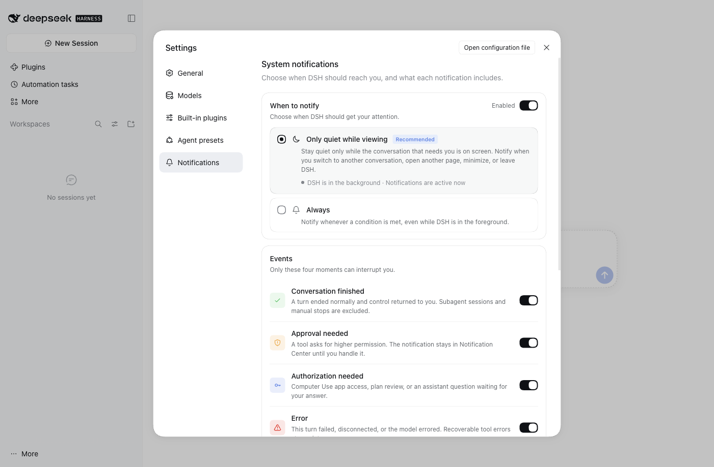

<div align="center">
  
  <h1>DSH System Notifications</h1>
  <p>Know when a conversation finishes, waits for approval or authorization, or fails.</p>

  <p>
    <a href="https://github.com/DaozeTang/dsh-system-notify/actions/workflows/ci.yml"></a>
    <a href="LICENSE"></a>
    
    =20" src="https://img.shields.io/badge/node-%3E%3D20-339933.svg">
  </p>

  <p><a href="README.zh.md">中文</a> · English</p>
</div>



> A community plugin for [DeepSeek Harness](https://github.com/deepseek-ai/deepseek-harness).
> Not an official DeepSeek product.

## Why

DSH is most useful when a task keeps running while you do something else. The
problem is that "something else" is usually another window, and the moment that
needs you is easy to miss: the turn finished, a tool is waiting for approval, a
plan needs confirmation, or the turn failed.

`dsh-system-notify` bridges that gap with the operating system notification
center. It is deliberately quiet: by default it stays silent only while the
conversation that needs you is the one on screen. Switch conversations, open
another page, minimize, or leave DSH, and it reaches you.

## Features

- **Four useful events** — conversation finished, approval needed,
  authorization needed, error.
- **Two timing modes** — quiet while viewing that conversation (default), or
  always. Staying in DSH is not enough: another conversation still notifies.
- **Click to return** — focuses DSH and opens the exact conversation; approval
  and authorization notifications land on the waiting card.
- **No approval from notifications** — the notification only brings you back.
  Approving still happens in DSH's own approval card.
- **Quiet by default** — no reply content unless you opt in, completion events
  are grouped, and repeated errors are throttled.
- **Native settings section** — lives in **Settings → Notifications**, using
  DSH's design tokens and native switch and card language.
- **Local only** — no network requests, no telemetry, no session-log writes, no
  model-facing tools.

## Install

Requirements: DSH `>=0.2.1-rc.2 <1.0.0`. For development, Node.js 20 or newer.

### From GitHub

Use DSH's plugin manager, or the CLI:

```bash
dsh plugin --profile desktop add github:DaozeTang/dsh-system-notify
```

Then add the bundle to the profile if the plugin manager did not do it for
you. Edit `~/.dsh/profiles/desktop/package.json`:

```json
{
  "dsh": {
    "profile": {
      "bundles": [
        "...",
        "dsh-system-notify"
      ]
    }
  }
}
```

Restart DeepSeek Harness completely (not just a window refresh).

### From a local checkout

```bash
git clone https://github.com/DaozeTang/dsh-system-notify.git
cd dsh-system-notify
dsh plugin --profile desktop add "file:$(pwd)"
```

Add `"dsh-system-notify"` to `dsh.profile.bundles` as above, then restart DSH.

### First run

1. Open **Settings → Notifications**.
2. Click **Allow notifications** and allow DSH in the operating system.
   - macOS: System Settings → Notifications → DeepSeek Harness.
   - Web: the browser's site settings for the DSH page.
3. Click **Send test notification**.
4. Switch to another conversation, or another app, and let a turn finish.

The plugin follows DSH's display language. English and Chinese are bundled.

## Configuration

Settings → Notifications. Every change saves immediately. The plugin's page on
the **Plugins** page in the sidebar still handles enabling and uninstalling, but
the preferences live in this settings section.

| Group | Setting | Default |
| --- | --- | --- |
| Timing | Only quiet while viewing / Always | Only quiet while viewing |
| Events | Conversation finished | On |
| Events | Approval needed | On |
| Events | Authorization needed | On |
| Events | Error | On |
| Content | Show conversation title | On |
| Content | Include reply preview | Off |
| Content | Play sound | On |

### When does it stay quiet?

DSH stays quiet only when all four are true:

1. the window is visible and focused;
2. the Settings dialog is closed;
3. the main panel shows the Conversation, not another page;
4. the conversation that needs you is the one selected in that panel.

Everything else notifies: a minimized or hidden window, DSH behind another app,
the Settings dialog, the Plugins page, no open conversation, or a different
conversation. The check runs when the event happens and again 250 ms before
sending; events that could not notify are never queued for later.

## How it works

The Host half listens to `session/event` and keeps the latest `turn/end` reason
in memory, so "finished", "stopped", "blocked", and "failed" are distinguishable
without reading history. The Browser half listens to session status and pending
interactions, applies the focus and current-conversation gate, and displays the
notification.

See [Design](docs/DESIGN.md) for the event model, architecture, and tradeoffs.

## Privacy

- No content is written to disk; the optional reply preview lives in the Host's
  memory only and is truncated to 80 characters.
- No network requests, no telemetry, no external service.
- The notification never contains approval buttons; it cannot grant permission.
- Reply previews are off by default because lock-screen notifications are public.

## Compatibility

- DSH `0.2.1-rc.2` through `0.3.x` (currently tested on `0.2.2-rc.5`).
- Desktop app and browser UI. Desktop notifications use the system notification
  center; the web UI uses the browser's notification permission.
- Node.js 20+ is required only for development and tests.
- Multiple connected clients evaluate focus and the open conversation
  independently; two clients viewing another conversation can both notify. This
  is a known v1 limitation.

## Development

```bash
npm test          # host + client unit tests
npm run check     # syntax check both halves
npm run test:host
npm run test:client
```

There are no runtime dependencies. The plugin is plain ESM: `index.js` is the
Host half, `client.js` is the Browser half, and `cordis.patch.yml` carries the
defaults. See [Contributing](CONTRIBUTING.md) for the local profile workflow.

## Repository layout

```text
.
├── index.js                 Host half: turn-end records, config, routes
├── client.js                Browser half: quiet gate, notifications, settings UI
├── cordis.patch.yml         Default config inserted into the DSH profile
├── locale/                  Package title/description and UI dictionaries
├── docs/                    Install, usage, design, screenshots
├── test/                    Node test runner suites
└── .github/                 CI, issue forms, pull request template
```

## License

MIT. See [LICENSE](LICENSE).
