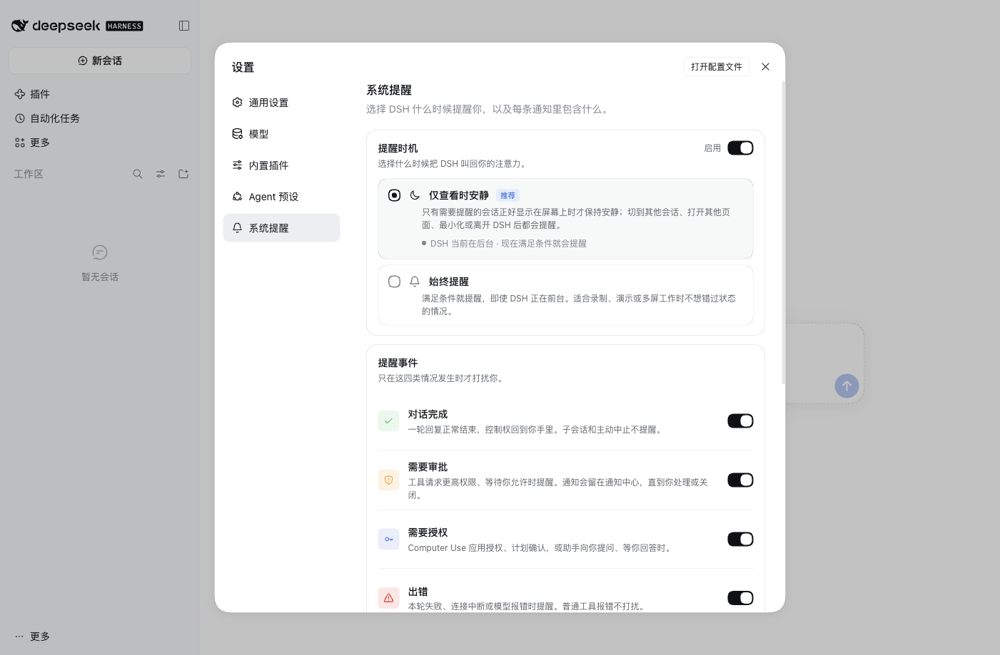

<div align="center">
  
  <h1>DSH 系统提醒</h1>
  <p>对话完成、等待审批或授权、出错时，用系统通知把你叫回来。</p>

  <p>
    <a href="https://github.com/DaozeTang/dsh-system-notify/actions/workflows/ci.yml"></a>
    <a href="LICENSE"></a>
    
  </p>

  <p>中文 · <a href="README.md">English</a></p>
</div>



> 这是一个社区插件，不是 DeepSeek 官方产品。

## 为什么

DSH 适合跑长任务，但人通常会切去写文档、看网页或开会。任务完成、工具请求审批、计划等待确认、或者本轮失败时，很容易错过。

`dsh-system-notify` 用系统通知中心补上这一段：默认只在需要提醒的会话正好显示在屏幕上时保持安静；切到其他会话、打开其他页面、最小化或离开 DSH，它都会把你叫回来。

## 功能

- **四个事件**：对话完成、需要审批、需要授权、出错。
- **两种时机**：查看对应会话时保持安静（默认），或始终提醒。即使 DSH 在前台，其他会话有进展也会提醒。
- **点击回到现场**：聚焦 DSH 并打开对应会话；审批/授权通知会定位到等待中的卡片。
- **通知里不做审批**：通知只负责把你带回来，允许/拒绝仍然在 DSH 的审批卡里完成。
- **默认克制**：回复摘要默认关闭，连续完成会合并，连续报错会节流。
- **原生设置分区**：位于 **设置 → 系统提醒**，使用 DSH 的设计令牌、原生开关和卡片节奏。
- **纯本地**：不发网络请求、不埋点、不写会话日志、不新增模型工具。

## 安装

要求 DSH `>=0.2.1-rc.2 <1.0.0`；开发需要 Node.js 20+。

### 从 GitHub 安装

用 DSH 的插件管理器，或命令行：

```bash
dsh plugin --profile desktop add github:DaozeTang/dsh-system-notify
```

如果插件管理器没有自动加入 bundle，请编辑
`~/.dsh/profiles/desktop/package.json`：

```json
{
  "dsh": {
    "profile": {
      "bundles": [
        "...",
        "dsh-system-notify"
      ]
    }
  }
}
```

然后**完全退出并重新打开** DeepSeek Harness。

### 从本地目录安装

```bash
git clone https://github.com/DaozeTang/dsh-system-notify.git
cd dsh-system-notify
dsh plugin --profile desktop add "file:$(pwd)"
```

把 `"dsh-system-notify"` 加入 `dsh.profile.bundles`，重启 DSH。

### 第一次使用

1. 打开 **设置 → 系统提醒**。
2. 点 **允许通知**，并在系统里允许 DSH。
   - macOS：系统设置 → 通知 → DeepSeek Harness。
   - Web：浏览器站点设置。
3. 点 **发送测试通知**。
4. 切到其他会话或其他应用，让一段对话完成，验证提醒。

## 配置

设置 → 系统提醒。更改立即保存。左侧边栏 **插件** 页只负责启用和卸载，具体偏好都移到了这个设置分区。

| 分组 | 设置 | 默认 |
| --- | --- | --- |
| 时机 | 仅查看时安静 / 始终 | 仅查看时安静 |
| 事件 | 对话完成 | 开 |
| 事件 | 需要审批 | 开 |
| 事件 | 需要授权 | 开 |
| 事件 | 出错 | 开 |
| 内容 | 显示会话标题 | 开 |
| 内容 | 包含回复摘要 | 关 |
| 内容 | 播放提示音 | 开 |

## 什么时候保持安静

只有以下三个条件同时成立时才不提醒：

1. 窗口可见且有焦点；
2. 主面板显示的是对话，而不是插件等其他页面；
3. 需要提醒的会话正是主面板里选中的会话。

其他情况都会提醒：窗口最小化或被遮挡、切到插件页、没有打开会话，或者正在
查看另一段会话。事件发生时判断一次，发送前 250ms 再判断一次；没有通过判断
的事件不会排队补发。

## 实现

Host 半侧监听 `session/event`，在内存里保留最近一次 `turn/end` 的原因，从而区分
完成、中止、拦截和失败；Browser 半侧监听会话状态和待处理交互，同时判断焦点和
当前查看的会话，再调用系统通知。详见 [设计文档](docs/DESIGN.md)（英文）。

## 隐私

- 不写盘；可选的回复摘要只存在 Host 内存里，最多 80 字符。
- 不发网络请求、不埋点、不依赖外部服务。
- 通知里没有审批按钮，不能代替用户授权。
- 锁屏通知是公开的，所以回复摘要默认关闭。

## 兼容性

- DSH `0.2.1-rc.2` 到 `0.3.x`（当前在 `0.2.2-rc.5` 验证）。
- 桌面端与浏览器版都支持；桌面用系统通知中心，浏览器用站点通知权限。
- 多客户端各自判断焦点，两个后台客户端可能都提醒；这是 v1 已知限制。

## 开发

```bash
npm test
npm run check
```

没有运行时依赖。`index.js` 是 Host，`client.js` 是 Browser，
`cordis.patch.yml` 是默认配置。贡献流程见 [CONTRIBUTING.md](CONTRIBUTING.md)。

## License

MIT，见 [LICENSE](LICENSE)。
