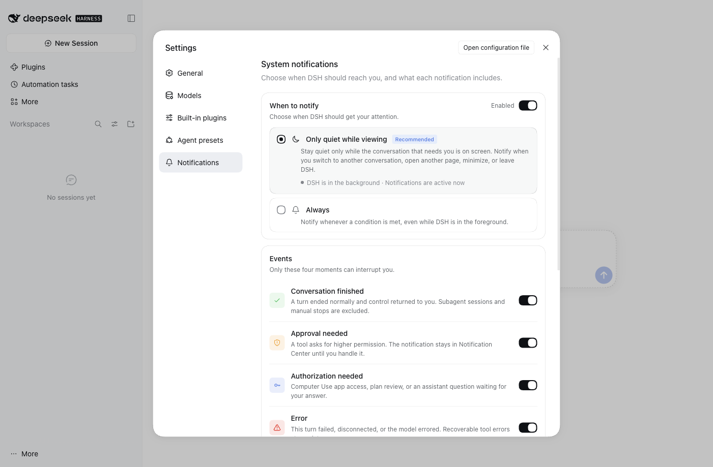

# Usage

[Back to README](../README.md) · [Install](INSTALL.md) · [Design](DESIGN.md)



## What triggers a notification

| Event | Triggers when | Does not trigger for |
| --- | --- | --- |
| Conversation finished | A main conversation's turn ends normally (`completed`). | Subagent sessions, manual stops, blocked or interrupted turns. |
| Approval needed | A main conversation publishes an approval interaction. | Approvals inside subagent sessions. |
| Authorization needed | A question, plan review, or Computer Use app consent waits for you. | Requests that already timed out or were answered elsewhere. |
| Error | The turn ends with `error`, or the session reports an error without a turn classification. | Recoverable tool errors that the turn survives. |

A notification is emitted once per turn or interaction. Repeated status events
are deduplicated.

## Timing modes

- **Only quiet while viewing** (default): stay quiet only when DSH is visible and
  focused, Settings is closed, the main panel is the Conversation, and the
  conversation that needs you is the one selected there. A minimized window,
  hidden tab, another app in front, the Settings dialog, the Plugins page, no open
  conversation, or a different conversation all notify.
- **Always**: notify even while you are viewing that conversation. Useful for
  recording, demos, and multi-screen setups.

The gate is checked twice: when the event happens and 250 ms before sending. If
the event cannot notify at that moment, it is dropped rather than queued.

## Settings

Settings → System notifications. The form is a top-level section in the Settings
panel, and the same page appears on the plugin's row on the sidebar's **Plugins**
page, which also enables or removes the bundle.

- Master switch.
- Timing: quiet while viewing, or always.
- Events: conversation finished, approval needed, authorization needed, error.
- Content: show conversation title, include reply preview, play sound.
- Permission and test notification.

Every change saves immediately through the plugin's own Host config row. Turning
the master switch off also closes notifications this client is showing.

## First run

1. Open **Settings → System notifications**.
2. Click **Allow notifications** and allow DSH in the operating system.
3. Click **Send test notification**.
4. Switch to another conversation or away from DSH and let a turn finish.

If notifications are blocked, the section shows the recovery steps and a
**Check again** button. On macOS the switch lives in System Settings →
Notifications → DeepSeek Harness. In a browser it is the site settings for the
DSH page.

## Notification content

- Title includes the conversation title by default; disable it for more privacy.
- Reply preview is off by default. When enabled, the Host keeps the first 80
  characters of the latest assistant text in memory only.
- Approval tool names are included when they are available. Full commands and
  file paths are never copied into a notification.
- Completion events within four seconds are grouped into one notification.
  Errors for the same conversation are throttled to one per minute.

## Privacy

- No content is written to disk by this plugin.
- No network requests, no telemetry, no external service.
- The notification cannot approve or reject anything; the DSH approval card is
  the only place that can grant permission.
- Lock-screen notifications are public; keep reply previews off if that matters.

## Known limits

- Every connected client evaluates focus and the open conversation independently.
  Two clients viewing another conversation can both notify.
- Focus modes and Do Not Disturb can suppress notifications. The plugin cannot
  detect or bypass them.
- The Host keeps turn-end classifications in memory; after a Host restart the
  client falls back to session status and error events.
- The Notification API is best-effort. Browsers may require a user gesture before
  granting permission; use the Allow notifications button in **Settings →
  System notifications**.
- If clicking a notification opens DSH but does not raise its window on a
  platform, that is a platform-specific window-focus limitation.

## Debugging

1. Check the permission row in **Settings → System notifications**.
2. Send a test notification.
3. Check the operating system's notification settings and Focus mode.
4. Check that the plugin is enabled on the **Plugins** page in the sidebar and
   that the bundle is listed in `dsh.profile.bundles`.
5. Open the browser console or DSH logs for `system-notify` warnings.

## Development

```bash
npm test
npm run check
```

The Host half is `index.js`, the Browser half is `client.js`, and the defaults
are in `cordis.patch.yml`. See [Contributing](../CONTRIBUTING.md).
